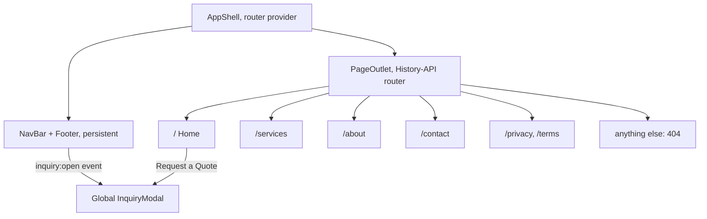

<p align="center">
  <picture>
    <source media="(prefers-color-scheme: dark)" srcset="public/images/DBF-Logo-White.png" />
    
  </picture>
</p>

<h1 align="center">Dickinson Bayou Fleeting</h1>

<p align="center">
  <b>Barge fleeting, marine services, and coastal dock leasing on the upper Texas Gulf Coast.</b>
</p>
<p align="center">
  The marketing and lead-generation site for a two-yard fleeting operation on Galveston Bay and the GIWW.<br />
  Live at <a href="https://dickinsonbayoufleeting.com">dickinsonbayoufleeting.com</a>.
</p>

<p align="center">
  
  
  
  
  
</p>

<br />

## Why Dickinson Bayou Fleeting

Fleeting is a phone-call business, so the site's job is to get a dispatcher to call: fast, from any page, on a phone with one bar out on the dock. That shapes everything: no framework routing, no CSS-in-JS, no cookie banner, and a quote request always one tap away. What is left is a small React bundle over a plain CSS token system.

<table width="100%">
  <tr>
    <td width="50%" valign="top">
      <p align="center"><b>Lead capture from anywhere</b></p>
      <p align="center">Any button dispatches an <code>inquiry:open</code> event. The app shell opens the modal, so triggers stay decoupled from the form.</p>
    </td>
    <td width="50%" valign="top">
      <p align="center"><b>No dependency it does not need</b></p>
      <p align="center">Routing, styling and the hero are hand-rolled. React and the shared footer bar are the whole of the shipped dependency tree.</p>
    </td>
  </tr>
</table>

<br />

## Stack

| Layer       | Technology                                                                                                                                                          |
| :---------- | :------------------------------------------------------------------------------------------------------------------------------------------------------------------ |
| UI          | React 19                                                                                                                                                            |
| Build & dev | Create React App (`react-scripts` 5)                                                                                                                                |
| Routing     | Custom History-API router in `src/app/router`, with no React Router                                                                                                 |
| Styling     | Plain CSS custom properties. One token set in `src/app/styles/Theme.css`, component rules colocated                                                                 |
| Type        | Barlow Condensed, IBM Plex Sans and JetBrains Mono, self-hosted; the two faces the first screen sets are preloaded from `public/fonts`                              |
| Theming     | Fixed dark page; per-section `[data-surface="light" \| "dark"]` flipping                                                                                            |
| Hero        | Canvas 2D procedural ocean-topography animation (reduced-motion and off-screen aware)                                                                               |
| Footer bar  | `@taylorurl/split-rail`, the shared credit bar every TaylorURL site mounts                                                                                          |
| Inquiries   | A Supabase edge function, called straight from the browser                                                                                                          |
| Analytics   | First-party and cookieless, from one hosted tracker                                                                                                                 |
| SEO & PWA   | Per-route titles, descriptions, canonicals and share tags from a head-sync hook; Schema.org JSON-LD, geo meta, web manifest and icon set, sitemap, robots, llms.txt |
| Hosting     | Vercel                                                                                                                                                              |

## Getting started

```bash
npm install
npm start                # CRA dev server at localhost:3000
npm run build            # production build to build/
```

No environment configuration is required. The three services the browser talks to — the inquiry function, the analytics tracker and the error collector — are addressed by URL in `src/app/constants/inquiryForm.js` and `public/index.html`. The only credential among them is the tracker's public site key, which sits beside its script tag, so there is no `.env` to fill in. The build runs on Node 22, and `CI=true npm run build` matches the Vercel build, where warnings fail the build.

### Scripts

| Script                 | Does                                                                                |
| :--------------------- | :---------------------------------------------------------------------------------- |
| `npm start`            | Start the CRA dev server.                                                           |
| `npm run build`        | Production build to `build/`.                                                       |
| `npm run lint`         | ESLint over `src`, warnings treated as fatal.                                       |
| `npm run format`       | Rewrite `src`, the `public` documents and the root JSON and Markdown with Prettier. |
| `npm run format:check` | Check the same set without rewriting.                                               |
| `npm test`             | Jest runner (no suites committed yet).                                              |
| `npm run eject`        | One-way CRA eject.                                                                  |

## Pages

`NavBar`, `Footer`, and the global `InquiryModal` persist across every route.

| Route         | Renders                                                                                                               |
| :------------ | :-------------------------------------------------------------------------------------------------------------------- |
| `/`           | Hero, services preview, lease rates, amenities, service area, facilities and maps, CTA, with a right-rail `ScrollSpy` |
| `/services`   | Seven-service catalog, lease rates, FAQ accordion, CTA                                                                |
| `/about`      | Company story, values, timeline, service area, CTA                                                                    |
| `/contact`    | Contact form, direct lines, both facility maps                                                                        |
| `/privacy`    | What the site collects, held in `src/app/constants/legal.js`                                                          |
| `/terms`      | Terms of use, from the same module                                                                                    |
| anything else | `NotFound`, served with a 404 status by `vercel.json` and marked `noindex`                                            |

## Architecture



## How it works

- **The router is three files.** `Router.js`, `Link.js`, and a `routes.js` table drive History-API navigation; React Router is not in the dependency tree.
- **Content lives in constants.** Facilities, services, lease options, FAQ, nav links, service area, and about copy are each a module under `src/app/constants`. The views only render them.
- **One form, two places.** The five inquiry fields, their rules and their error wording live in `src/app/constants/inquiryForm.js`; `InquiryFields` renders them for both the modal and the contact page. Both forms post to a Supabase function through the shared submit, which gives up after 15 seconds and shows a failure instead of a confirmation.
- **The water draws itself.** `OceanTopographyBackground` rides a dot field and its contour lines on one shared flow field over a Canvas 2D context, behind the home hero and behind every inner page header. It stops while off-screen or in a hidden tab, and paints a single static frame under `prefers-reduced-motion`.
- **Two yards, one record.** San Leon (2629 Avenue R, Dickinson, TX) at $4,100/month and Freeport (906 Marlin Ln, Freeport, TX) at $4,800/month, both 5-acre waterfront facilities, come from `src/app/constants/facilities.js`, which the lease cards, the maps, the footer and the contact page all read. The hero console keeps its own short list because it shows coordinates the record does not carry.
- **A broken page reports itself.** An inline script in `public/index.html` catches uncaught errors, rejected promises, failed resource loads and 5xx responses, caps itself at ten reports a visit and beacons them to the collector. The privacy page says so, because those reports are one of the three things the site records.
- **Routes are downloaded one at a time.** Each view is a `lazy` import behind a `Suspense` fallback, and `RouteBoundary` reloads once when a chunk goes missing — the shape of a deploy landing while a tab is still open.

## Project structure

```
dickinsonbayoufleeting-com/
├── eslint.config.js           Flat config; the rules that hold outside the CRA build
├── performance-budget.json    The recorded weight budget for the built bundle
├── vercel.json                Route rewrites, asset caching, the 404 status
├── public/
│   ├── favicon*, apple-touch-icon.png, android-chrome-*.png
│   ├── fonts/                 The two faces the first screen sets, preloaded
│   ├── images/                DBF wordmark, black and white, at three sizes
│   ├── index.html             Head metadata, error reporter, analytics, JSON-LD
│   ├── manifest.json          PWA manifest and icon set
│   ├── release.json           Deployed version marker
│   └── llms.txt, robots.txt, sitemap.xml
└── src/
    ├── index.js               React root
    ├── app/
    │   ├── App.js             AppShell: nav, routed outlet, footer, inquiry modal
    │   ├── router/            History-API router (Router, Link, routes)
    │   ├── constants/         facilities, services, leaseOptions, faq, inquiryForm, …
    │   ├── fonts/             The remaining subsets and weights as woff2
    │   ├── hooks/             useSeoMeta, useBreadcrumbSchema, useReveal, useCountUp,
    │   │                      useScrolled, useClickRipple
    │   └── styles/            Fonts.css faces, Theme.css tokens + global CSS
    ├── views/                 Home, Services, About, Contact, Privacy, Terms
    ├── pages/                 NotFound
    └── components/            Section and UI components (+ colocated styles/)
```

## License

Copyright (c) 2026 Trenton Taylor. All rights reserved. See [LICENSE.md](LICENSE.md).

<br />

<p align="center">
  <sub>Built by <a href="https://taylorurl.com">TaylorURL</a>. Custom sites for local businesses.</sub>
</p>
